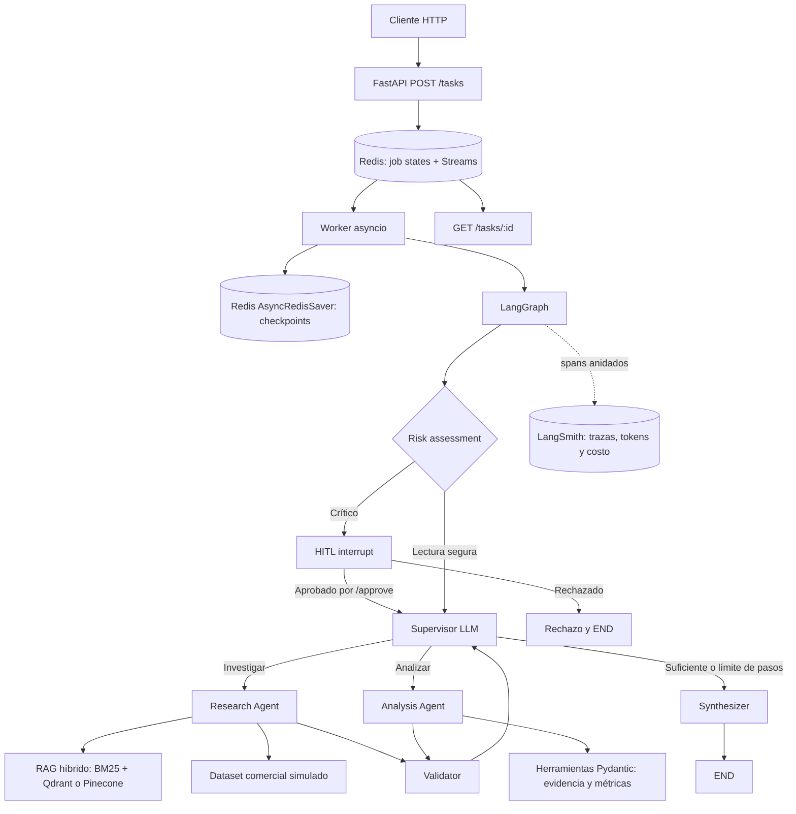

# The Intelligence System — Proyecto final AI Engineering

**Python 3.12 · LangGraph · LangChain · FastAPI · Redis 8 · Qdrant/Pinecone · RAG híbrido · LangSmith · HITL**

Sistema de investigación técnica y análisis multiagente con una **API asíncrona desacoplada de un worker**, recuperación híbrida de documentos con trazabilidad de fuentes, un Supervisor LLM que decide la delegación, validación independiente de resultados, memoria persistente en Redis y aprobación humana para tareas críticas. No es una cadena lineal: el validador puede devolver la ejecución al Supervisor para corregir faltantes.

El trabajo refactoriza la **Pre-entrega 4** ([pinecone-hybrid-rag](https://github.com/hernansoto/pinecone-hybrid-rag)), **Pre-entrega 6** ([multi-agent-research-orchestrator](https://github.com/hernansoto/multi-agent-research-orchestrator)) y **Pre-entrega 7** ([api_multiagente_preEntrega7](https://github.com/hernansoto/api_multiagente_preEntrega7)). El corpus técnico incluido es una **adaptación condensada** del de M4, no una copia textual completa; también se conserva el dataset comercial **ficticio** Starter/Growth de M6. El backend vectorial por defecto es Qdrant local, para no exigir un índice Pinecone como prerrequisito de la demo; Pinecone es opcional.

> **Estado de verificación:** el código está preparado para despliegue local, pero deben ejecutarse las pruebas end-to-end con Docker, claves de proveedores reales y capturar trazas reales en LangSmith. Las capturas del dashboard **no están incluidas hasta ejecutar las pruebas**. No confundir el test offline con una validación completa de producción.

## 1. Arquitectura: decisiones y topología



**Motivos:**

- **Separación API/worker**: devolver `202` sin llamadas al modelo en el event loop HTTP. Redis Streams persiste trabajos y habilita múltiples consumidores.
- **Supervisor jerárquico, no enrutamiento `if/else` por keywords**: `with_structured_output` decide si llamar investigador, analista o síntesis. La política de pasos acota el bucle.
- **RAG de dos señales**: embeddings densos con `OpenAIEmbeddings.aembed_query`, consultas vectoriales async Qdrant/Pinecone y BM25 local; **Reciprocal Rank Fusion** combina resultados usando ID estable y weights configurables.
- **Contexto mínimo**: agentes reciben solicitud, evidencia relevante y errores de validación, no todo el historial; `MessagesState` sigue acumulando mensajes para memoria del thread.
- **Validator separado**: exige fuente identificable y tool analítica; verifica las citas propuestas por el analista y recalcula determinísticamente las métricas comerciales. Los conflictos se devuelven al Supervisor.
- **HITL fail-closed**: en operaciones potencialmente peligrosas, pagas o sensibles, `interrupt()` detiene el grafo y el reviewer aprueba/rechaza con un endpoint protegido. La aprobación **no concede herramientas de escritura**: este demo no ejecuta acciones destructivas.
- **Persistencia real**: Redis 8 (JSON y Search) para `AsyncRedisSaver`, estados y cola; Qdrant con volumen separado para persistencia de los vectores. Checkpointer inicializado mediante `await checkpointer.asetup()`.
- **Trazas**: `@traceable` y captura automática de operaciones de LangChain/LLMs con LangSmith cuando está configurado. Consultar `job_id`, `thread_id` y `batch_id` por metadata/tags.

### Estructura

```text
intelligence-system-final/
├── app/
│   ├── main.py                 # API, modelos Pydantic, Swagger
│   ├── config.py               # Configuración por variables de entorno
│   ├── store.py                # Redis Streams, estado, locks
│   ├── worker.py               # AsyncRedisSaver y ejecución en segundo plano
│   ├── graph.py                # StateGraph jerárquico
│   ├── hitl.py                 # interrupt, riesgo y aprobación
│   └── observability.py       # LangSmith spans
├── orchestrator/
│   ├── state.py                # MessagesState + trazabilidad por especialista
│   ├── supervisor.py           # Router estructurado
│   ├── validation.py           # Rúbrica de validación
│   ├── synthesis.py            # Respuesta final citada
│   ├── agents/                 # Investigador y analista
│   ├── tools/                  # Herramientas acotadas por agente
│   ├── domain/                 # Lógica pura de cálculos / búsqueda simulada
│   └── data/sources.json       # Dataset comercial ficticio M6
├── rag/
│   ├── schemas.py              # Contratos de evidencia/chunks
│   ├── corpus.py               # JSON → chunks con metadata
│   └── retriever.py            # BM25 + Qdrant/Pinecone async + RRF
├── knowledge/                  # Dataset técnico adaptado M4
├── scripts/                    # Cinco pruebas concurrentes y demo HITL
├── examples/conversation.py    # Continuidad con thread_id
├── tests/                      # Tests automatizados
├── screenshots/                # Pendiente evidencia real LangSmith
├── Dockerfile
├── docker-compose.yml
├── requirements.txt
└── .env.example
```

## 2. Arranque local: una instrucción

Requisitos: Docker Desktop con Docker Compose y **OpenAI API key** (LLM y embeddings). Para trazas también se requiere **LANGSMITH_API_KEY**. No se requiere Pinecone con el backend predeterminado.

1. Copiar el archivo de configuración: `Copy-Item .env.example .env` (PowerShell) o `cp .env.example .env` (Linux/macOS).
2. Completar **OPENAI_API_KEY**, **LANGSMITH_API_KEY** y un valor privado fuerte para **APPROVAL_API_KEY** en `.env`.
3. Iniciar todos los servicios con **un solo comando**:

```bash
docker compose up --build -d
```

El primer inicio del worker genera embeddings del corpus de demostración (tiene costo del proveedor), crea la colección en Qdrant y deja los documentos indexados. La siguiente vez reutiliza el índice mientras el volumen persista. El worker requiere claves configuradas; si faltan, la API puede levantar pero **no procesará tareas**. No se debe confundir un `/health` correcto con un test funcional completado.

```bash
docker compose ps
docker compose logs -f worker
```

Swagger: **http://localhost:8000/docs**  ·  Health: **http://localhost:8000/health**

Para detener: `docker compose down` (no destruye volúmenes). `docker compose down -v` **elimina** también checkpoints y vectores, y la próxima ingesta volverá a consumir embeddings.

### Alternativa Pinecone (de Pre-entrega 4)

En `.env`: `VECTOR_BACKEND=pinecone`, `PINECONE_API_KEY=...`, `PINECONE_INDEX=...`, `PINECONE_NAMESPACE=technical-docs`. Crear antes un índice denso cosine con dimensión **EMBEDDING_DIMENSIONS** (`1536` por defecto). El backend utiliza el cliente **AsyncPinecone** sin llamadas HTTP bloqueantes. Si el índice contiene los documentos de M4 con distinto esquema/chunking, creá otro namespace para esta integración. **No** mezclar embeddings de modelos o dimensiones distintas. Qdrant sigue disponible para despliegue íntegramente local.

## 3. Probar la API

### Crear tarea de investigación y análisis

```powershell
$body = @{ task = "Compará Pydantic y FastAPI para validar una API de IA, investigá las fuentes y evaluá riesgos" } | ConvertTo-Json
$job = Invoke-RestMethod -Uri http://localhost:8000/tasks -Method Post -ContentType 'application/json' -Body $body
$job
Invoke-RestMethod -Uri "http://localhost:8000/tasks/$($job.job_id)"
```

Si configuraste `API_KEY`, agregar `-Headers @{"X-API-Key"="tu_clave"}` a ambas peticiones. `POST /tasks` responde `202`, con `job_id`, `thread_id` y `status_url`. El `GET` devuelve `PENDING`, `RUNNING`, `WAITING_APPROVAL`, `APPROVAL_QUEUED`, `DONE` o `FAILED`, y también `completed` y `validation_errors`.

### Memoria persistente y checkpoints

El `thread_id` es el identificador del checkpoint. Para una siguiente pregunta, enviá **otro** `POST /tasks` con el `thread_id` anterior, una vez terminada la tarea. El historial de mensajes permanece en Redis tras reiniciar API/worker, siempre que el volumen Redis sobreviva. Solo se permite **una tarea activa por thread** mediante un lock Redis de 24 horas para evitar escrituras concurrentes de checkpoints.

```json
{"task":"¿Cómo aplicar eso con una API asíncrona? Citá fuentes", "thread_id":"UUID_ANTERIOR"}
```

Ejemplo ejecutable: `python examples/conversation.py` (instalar requisitos locales).

### Human-in-the-loop

```bash
docker compose exec api python scripts/critical_demo.py --url http://127.0.0.1:8000
```

También puede ejecutarse desde un entorno Python local: `python scripts/critical_demo.py`.

La solicitud crítica debe quedar en `WAITING_APPROVAL`; `GET /tasks/{id}` incluirá `approval_request`. El revisor externo envía:

```http
POST /tasks/{job_id}/approve
Content-Type: application/json
X-Approval-Key: <APPROVAL_API_KEY>

{"approved":true,"reviewer":"evaluador","comment":"Autorizado para demo"}
```

`approved=false` termina en rechazo y no llama a los especialistas. Dos aprobaciones simultáneas para la misma tarea producen un conflicto `409` (Redis WATCH). El comando `python scripts/critical_demo.py --reject` demuestra el rechazo. Para probar con `APPROVAL_API_KEY`, copiar **.env.example** a .env local antes de ejecutar scripts.

## 4. Prueba de cinco peticiones concurrentes y observabilidad

El script emite **cinco peticiones simultáneas y diferentes** que cruzan RAG, supervisor y analista. Cuatro son técnicas y la quinta usa el dataset numérico ficticio. Cada ejecución del worker se traza con el mismo `batch_id`.

**Sin instalar Python local**, usar el contenedor de la API (los scripts ya están en la imagen):

```bash
docker compose exec api python scripts/load_test.py --url http://127.0.0.1:8000
```

Alternativamente, con Python 3.12 local:

```powershell
py -3.12 -m venv .venv
.\.venv\Scripts\Activate.ps1
pip install -r requirements-dev.txt
python scripts/load_test.py --url http://localhost:8000
```

En Linux/macOS usar `python3.12 -m venv .venv && source .venv/bin/activate`.

El script guarda `screenshots/load5-report.json` **cuando se ejecuta realmente**. Docker Compose monta ese directorio desde el host para que el informe generado dentro del contenedor quede en la carpeta del repositorio. El JSON es una medición cliente, **no** sustituye el costo por ejecución ni el p95 calculados por LangSmith.

**Capturas obligatorias antes de entregar**, ubicarlas como imágenes reales dentro de `screenshots/`:

1. `01-traces.png`: cinco runs en LangSmith del proyecto `LANGSMITH_PROJECT`, filtro `batch_id=final5-...` o búsqueda por tags/metadata, con grafos/spans visibles.
2. `02-cost-per-run.png`: costo por cada ejecución que **LangSmith calcula** a partir de los tokens y el modelo configurado (si no aparece, revisar identificación del modelo y tabla de precios de LangSmith).
3. `03-latency-p95.png`: latencia p95 del proyecto o de las cinco ejecuciones filtradas, medida en el dashboard.
4. `04-hitl-approval.png`: traza de pausa por `interrupt` y reanudación/rechazo (puede requerir dos vistas).

**No subir imágenes inventadas, pantallas de ejemplo o screenshots de otra corrida**. El directorio contiene instrucciones, no evidencia hasta que se hagan las pruebas reales. Seguir `screenshots/README.md`.

### Pruebas automatizadas

```bash
pytest -q
```

Para revisar dependencias y estilos opcionalmente: `python -m compileall -q app orchestrator rag scripts` y `ruff check .`.

## 5. Contratos, estados, fallos y límites

- Entradas y salidas FastAPI definidas con **Pydantic v2**: `TaskRequest`, `TaskAccepted`, `TaskStatus`, `ApprovalRequest`, `ApprovalAccepted`.
- Documentos del corpus y resultados del RAG definidos como `KnowledgeDocument`, `Chunk`, `ResearchSource`; `SearchArgs` valida cada consulta. `EvidenceArgs`/`EvidenceAssessment` validan la tool de evaluación; `PlanArgs`/`PlanMetricsContract` validan matemáticas.
- El checkpointer registra en Redis `MessagesState`, contribuciones, `validation_errors`, rutas de agentes, y estado HITL. El supervisor hace como máximo `max_steps` decisiones (por defecto 8), con cierre parcial en caso de evidencia insuficiente.
- Errores de worker se capturan y cambian job a **FAILED**; si Redis no permite guardar FAILED, el evento queda pendiente para recuperación; recuperación de streams pendientes tras 15 min evita reejecuciones ciegas con efectos no idempotentes.
- Una respuesta puede finalizar con `status=DONE` y `completed=false` si el máximo de pasos alcanzó la síntesis parcial: el cliente **debe inspeccionar** `completed` y `validation_errors` antes de asumir que se resolvió.
- Costo: modelo y embeddings externos pueden facturar. No hay presupuesto automático por tokens; `max_steps`, top-k y concurrencia acotan parte del trabajo, pero no equivalen a garantías de costo.
- Seguridad: el proyecto es un **prototipo local orientado a prácticas de producción**, no un servicio endurecido para Internet. Para exponerlo públicamente agregar autenticación obligatoria, TLS, rate limiting, cifrado, aislamiento multiusuario, retención, RBAC del reviewer, auditoría e idempotencia más robusta.
- Los documentos RAG son material de referencia, **no instrucciones** para el sistema: se prohíbe obedecer comandos contenidos en fuentes recuperadas.

## 6. Verificación de una entrega limpia

```bash
git clone <URL_PUBLICA_DEL_REPO> final-clean
cd final-clean
cp .env.example .env  # configurar claves propias
docker compose up --build -d
curl http://localhost:8000/health
```

Antes de pushear: `git status`, `git check-ignore .env` y `git diff --cached --name-only`; **nunca subir `.env` ni credenciales**. Conservá el repo en la cuenta personal `hernansoto` sin alterar la cuenta laboral `sotohernan` (manejar con `gh auth switch --user hernansoto` y volver después).

## 7. Correspondencia con la rúbrica

| Criterio | Evidencia en código |
|---|---|
| Arquitectura y coherencia (30%) | `app/graph.py`, `orchestrator/`, `rag/` y diagrama arriba |
| Robustez técnica (25%) | `async/await`, worker Redis Streams, Pydantic en API/tools |
| Persistencia y observabilidad (20%) | `AsyncRedisSaver`, Redis 8, LangSmith y capturas reales pendientes |
| Documentación y despliegue (15%) | `README.md`, Docker Compose, demos y guías |
| Entorno y estándares (10%) | `python:3.12-slim`, requisitos y `.env.example` |

**Procedencia de código:** M4 aportó chunking, metadata, combinación BM25/vector y RRF; M6 aportó supervisor con especialistas, herramientas e investigación/cálculos de dataset ficticio; M7 aportó worker Redis Streams, endpoints asíncronos, checkpoint e HITL. El refactor agrega contratos transversales, Qdrant local y validación de citas. Los datos técnicos condensados pueden diferir en redacción del dataset completo de M4 y no deben usarse como documentación oficial de las bibliotecas.
